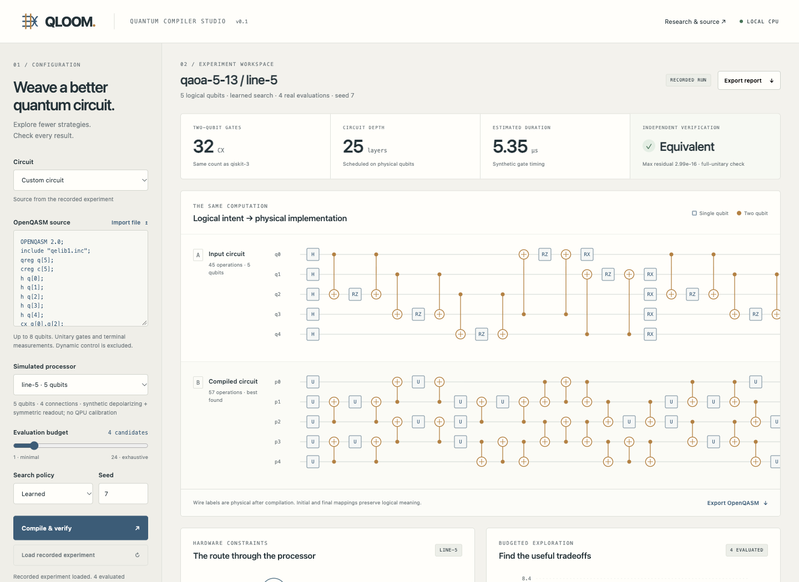
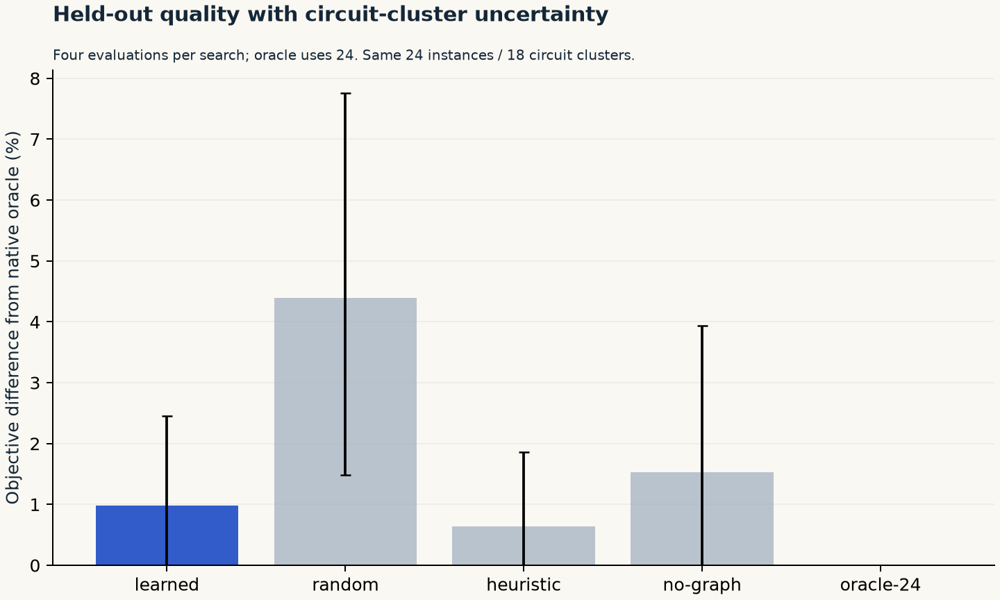

<p align="left"></p>

# Weave better quantum circuits. Check every result.

**QLOOM is a CPU quantum compiler and interactive research Studio with a trained, graph-aware search policy.** It imports a circuit, ranks native compilation strategies, evaluates a strict candidate budget, independently checks logical meaning, and exports the physical circuit with its mappings, phase and experiment report.

[Quickstart](#run-the-studio) · [How it works](docs/method.md) · [Measured experiments](docs/experiments.md) · [Semantics contract](docs/semantics.md) · [Research foundations](docs/research-foundations.md) · [Launch film](https://github.com/nazeeh111/QLOOM/releases/download/v0.1.0/qloom-launch.mp4)



## A compiler you can inspect

QLOOM implements its own commutation rewrites, graph-based placement refinement, shortest-path-progress routing and lookahead SWAP selection. Qiskit supplies circuit interchange and standard **gate translation**; the QLOOM compiler does not delegate layout or routing to `transpile`. Qiskit levels 0–3, MQT QMAP and BQSKit run separately as measured baselines.

A 48-tree ensemble learns from **2,880 real, independently verified compiler evaluations on 120 unique training circuits**. At inference, a safe JSON tree interpreter ranks 24 configurations using 28 circuit, processor, placement and strategy features. A four-evaluation budget compiles exactly four candidates. No API key, paid quantum hardware or GPU is required.

The Studio shows input/physical circuits, interactive connectivity and logical placement, recorded routing replay, candidate costs and Pareto tradeoffs, verification residuals, baseline outcomes and synthetic noise assumptions. Every displayed result comes from a genuine report. The recorded demo is labeled; compiling your own source runs the actual Python pipeline.

## What the experiment establishes

The release includes 24 held-out circuit/device cases, **18 unique numerical circuit inputs**, three requested search seeds, an unseen star topology, unseen circuit families, a 24-configuration native oracle and two ablations. Repeated seeds and topologies are clustered by circuit input for uncertainty. The main native methods receive the same four-evaluation budget.

| Search method | Evaluations | Mean CX gates | Mean hardware objective ↓ | Native-oracle hit rate |
| --- | ---: | ---: | ---: | ---: |
| Learned QLOOM | 4 | 13.625 | 15.666 | 83.3% |
| Random | 4 | 14.264 | 16.401 | 68.1% |
| Distance heuristic | 4 | 13.583 | 15.619 | 87.5% |
| Retrained graph-free ablation | 4 | 13.708 | 15.761 | 83.3% |

Learned minus random paired objective difference is **−0.734**, with a circuit-cluster bootstrap 95% interval of **[−1.519, −0.153]**. Four evaluations use 83.3% fewer candidate evaluations than enumerating all 24; that is an evaluation-count comparison, not a wall-time speedup claim.

**The learned policy does not beat the strong distance heuristic on this suite. Qiskit level 3 is better overall. The graph-feature ablation does not establish a statistically clear advantage, and transfer to the held-out star topology was worse than random search.** These are small synthetic experiments, not state-of-the-art or real-QPU claims. BQSKit covers an explicit four-case subset; external compiler efforts differ and failed equivalence checks are retained. Read the [complete results, denominators and unsuccessful cases](docs/experiments.md).



The flagship QAOA example finds **32 CX**, tying Qiskit levels 2 and 3, compared with 44 for level 0 and 39 for QMAP on that run. Its BQSKit call timed out at 45 seconds and is displayed as unavailable. Other BQSKit comparisons completed successfully in the benchmark subset. This one demo is not evidence of broad superiority.

## Run the Studio

Use **Python 3.11–3.13**; the full research environment was measured on Python 3.12. The core package includes the trained model and recorded experiment.

```sh
git clone https://github.com/nazeeh111/QLOOM.git
cd QLOOM
python3 -m venv .venv
source .venv/bin/activate
python -m pip install '.[research]'
qloom studio
```

Open **http://127.0.0.1:8765**. If that port is busy, use `qloom studio --port 18765`. Everything runs locally. The default external compiler limit is 45 seconds per invocation, including worker startup; failures and timeouts remain visible. `QLOOM_BASELINE_TIMEOUT` accepts 1–300 seconds.

For a lighter installation, `pip install .` provides native compilation, trained inference and the Studio. Optional external compilers and noisy simulations appear as unavailable until the research extras are installed. The stored real demo remains inspectable.

## Compile and export

```sh
qloom compile examples/qaoa.qasm --device line-5 --budget 4 --seed 7 --out my-run
# Fast native-only check, without external baselines or optional noise dependencies:
qloom compile examples/ghz.qasm --device line-5 --budget 4 \
  --skip-baselines --skip-noise --out my-native-run
```

The output bundle contains `optimized.qasm`, **`metadata.json`** and `report.json`. **Keep the JSON with the QASM.** OpenQASM2 cannot represent global phase or logical placement. Both initial and final mappings are required to interpret arbitrary quantum inputs and outputs. Exported terminal measurements already target the original classical bits. [Full contract and reload guidance](docs/semantics.md).

```python
from qiskit import QuantumCircuit
from qloom import compile_circuit, make_device

circuit = QuantumCircuit(5)
circuit.h(0)
for q in range(1, 5):
    circuit.cx(0, q)

report = compile_circuit(
    circuit, make_device("line", 5), budget=4, seed=7,
    baselines=False, noisy=False,
)
best = next(c for c in report["candidates"] if c["id"] == report["best_id"])
assert best["verification"]["passed"]
print(best["metrics"], best["initial_mapping"], best["final_mapping"])
```

## Meaning before metrics

The independent NumPy interpreter compares the complete logical operator, accounting for **both placements and global phase**, plus eight randomized complex inputs. It uses explicit gate definitions, independent of compiler rewrites. Terminal measurement exports are reparsed and checked with separate statevector simulations and original classical destinations. Standard gate identities are validated to reject custom-name spoofing. Tests intentionally corrupt phase, mappings and gates.

QMAP/BQSKit can discard global phase during conversion/synthesis. QLOOM records and restores a single scalar phase, then applies the strict full check. Non-global errors still fail. Noisy-output similarity is never accepted as logical equivalence.

Version 0.1 deliberately supports **2–8 qubits, a bounded standard gate set, connected bidirectional U/CX devices, and terminal measurements**. It rejects custom/opaque gates, dynamic control, resets, unbound parameters, intermediate measurements, repeated measurements and classical overwrite. Logical and physical widths must match. Density-matrix noise evaluation is bounded to six qubits. [Supported operations and limits](docs/semantics.md).

Noise and durations are **synthetic**: independent U/CX depolarization, symmetric readout errors and fixed gate durations. The success-product estimate is a heuristic; the simulated fidelity compares output distributions on a zero logical input. No hardware measurements, T1/T2, crosstalk or pulse-level accuracy are claimed.

## Architecture and reproduction


```sh
python -m pip install '.[research,dev]'
python -m pytest -q
qloom train --out reproduced-models/surrogate.json
qloom benchmark --out reproduced-benchmarks
python scripts/plot_results.py --root .
python scripts/reproduce_native.py
```

Training and benchmarks use fixed seeds and recorded configurations. [The protocol](docs/experiments.md) explains data splits, the held-out topology, timing, uncertainty, ablations, optional baseline timeouts and the offline-only budget curves. Numerical plots are generated directly from saved result files. `models/` and `benchmarks/` retain QASM, global phases, versions, raw labels, outcomes, model digests and source fingerprints. The release includes a pinned Python 3.12 research environment file, editable SVG diagrams, launch sources and original audio provenance.

| Location | Contents |
| --- | --- |
| `src/qloom/routing.py` | Native rewrites, placement and routing |
| `src/qloom/verify.py` | Independent operator/statevector checks |
| `src/qloom/training.py`, `experiments.py` | Reproducible offline training and held-out evaluation |
| `src/qloom/data/` | Packaged JSON model, genuine demo and benchmark summary |
| `src/qloom/web/` | Local interactive Studio, no CDN dependencies |
| `examples/` | OpenQASM inputs and actual export bundles |
| `models/`, `benchmarks/` | Real training/evaluation evidence and reproduction checks |
| `docs/`, `launch/` | Method, attribution, editable diagrams, plots, screenshots and film sources |

## License

QLOOM code uses **Apache-2.0**. Dependencies and rendering assets retain their own licenses, including BQSKit's full Berkeley Lab terms. See [THIRD_PARTY.md](THIRD_PARTY.md), [NOTICE](NOTICE) and the launch provenance.
